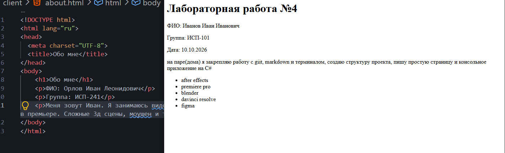
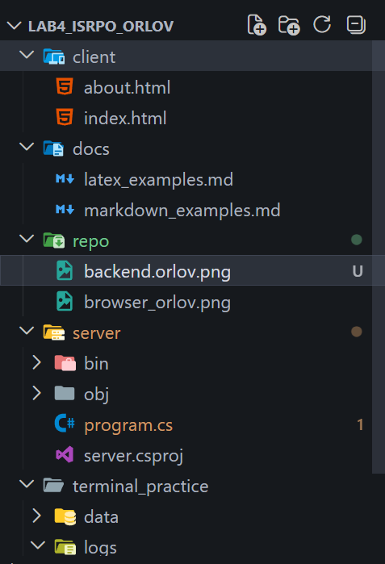
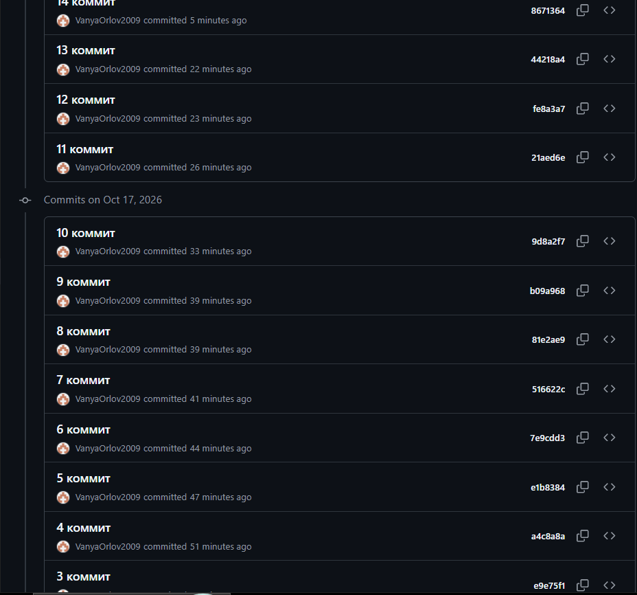

# Лабораторная работа №4

ФИО: Орлов Иван Леонидович
Группа: ИСП-241
Дата: 17.10.2026

## Описание проекта
Закрепили навыки работы с git, markdow и терминалом. Создали свое консольное приложение на C#

## Содержание
- [Структура проекта](#структура-проекта)
- [Примеры Markdown](#примеры-markdown)
- [Примеры LaTeX](#примеры-latex)
- [Репозиторий](#репозиторий)
- [Скриншоты](#скриншоты)
- [Заключение](#заключение)

## Структура проекта
Lab4_ISRPO_orlov/
├── client/
│   ├── about.html
│   └── index.html
├── docs/
│   ├── latex_examples.md
│   └── markdown_examples.md
├── repo/
│   ├── browser_orlov.png
│   ├── backend_orlov.png
│   ├── terminal_orlov.png
│   └── git_orlov.png
├── server/
│   ├── Program.cs
│   └── server.csproj
├── terminal_practice/
│   ├── data/
│   │   └── text.txt
│   └── logs/
│       └── app.log
└── README.md


## Примеры Markdown
Заголовок: `## Заголовок`
Список:
- пункт 1
- пункт 2

Картинка: ``

```
Console.WriteLine("Привет, Мир!");
```

## Примеры LaTeX
Inline: $a^2 + b^2 = c^2$

$$
\sum_{i=1}^n i = \frac{n(n+1)}{2}
$$

## Репозиторий
[Lab4_ISRPO_orlov](https://github.com/VanyaOrlov2009/Lab4_ISRPO_orlov)

## Скриншоты





## Заключение
Я закрепил навыки работы с git, markdown и терминалом